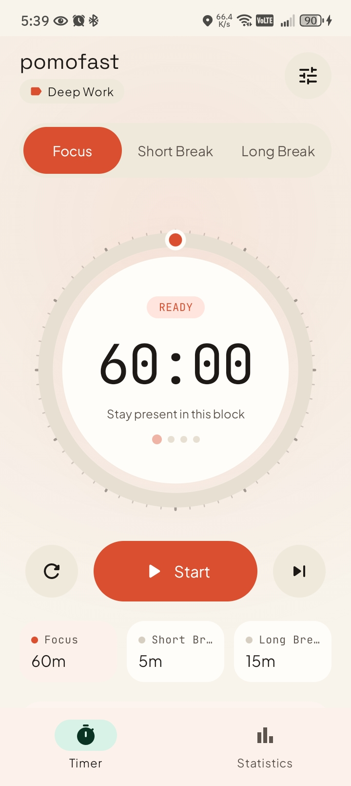

# pomofast

A minimalist Android Pomodoro timer with customizable focus & break intervals and a productivity dashboard.

## Features

- **Pomodoro Timer**: Focus, Short Break, and Long Break modes with custom durations, presets, tags, chime, and haptics.
- **Productivity Dashboard**: Interactive daily, weekly, monthly (heatmap), and annual progress charts, streaks, and manual logging.
- **Local Storage**: Offline-first persistence built with Kotlin, Jetpack Compose, Material 3, Room, and DataStore.

